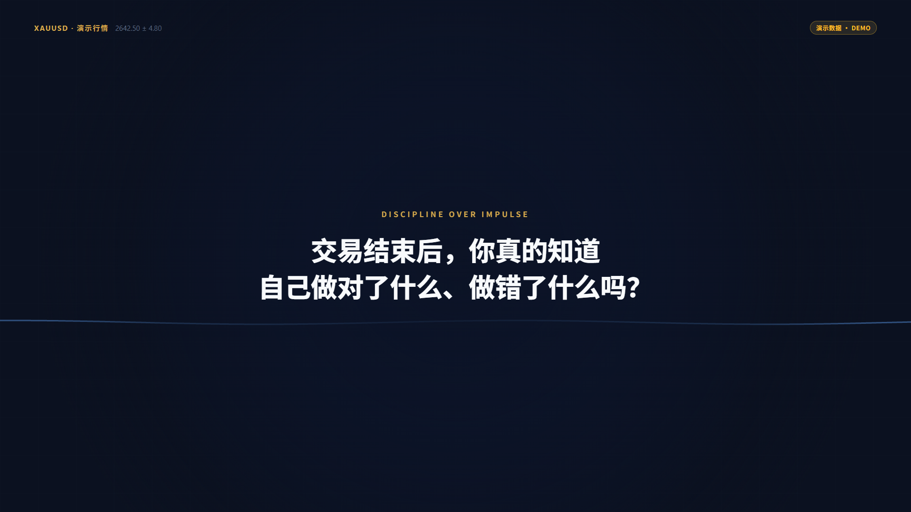

# Trading Discipline OS

Local-first XAUUSD trading journal and SOP discipline coach. Recording, review, and discipline support only — **never places orders, modifies SL/TP, or holds trading credentials**.

## 60-Second Promo Video

**DISCIPLINE OVER IMPULSE** — deterministic code-rendered 1080p/30fps product showcase (`promo-video/`):

[](promo-video/output/Trading-Discipline-OS-Promo-60s.mp4)

- **Watch / Download MP4 (1080p H.264)**: [Trading-Discipline-OS-Promo-60s.mp4](promo-video/output/Trading-Discipline-OS-Promo-60s.mp4)
- **Scene Highlights**:
  - [Act 1 — Noise vs. Discipline](promo-video/output/previews/02_act1_question_6.8s.png) · [Act 3 — MT5 Read-Only Sync](promo-video/output/previews/06_act3_mt5sync_21.0s.png) · [Act 4 — Process vs. Outcome](promo-video/output/previews/10_act4_matrix_37.0s.png) · [Act 5 — What-If & AI Coach](promo-video/output/previews/12_act5_whatif_46.0s.png)
- See [promo-video/README.md](promo-video/README.md) to regenerate audio or re-render the film locally.

## Key Features
- **Command Center**: Next discipline action, interactive equity curve, 30-day SOP compliance, War Account loss-limit and post-loss funding alerts, and a 60-second pre-session check with local calendar status and LDR 2026 notices.
- **Journal & Calendar Heatmap**: Monthly P&L and review-status calendar, 3-in-1 daily ledger / journal note / trade card panel, local draft auto-save & confirm-exit protection, and Layering setup merge/split.
- **MT5 Read-Only Dual-Channel Sync**: Near-real-time local JSON file watcher (`mt5/DisciplineOS_ReadOnlySync.mq5`, zero `OrderSend`) plus HTML/CSV/XLSX/JSON report import with `deal_ticket` deduplication.
- **Weekly Review & What-If Simulator**: Process-vs-Outcome matrix, deterministic What-If discipline simulator, and Pi-style local CLI AI Coach (`agy-cli`, `codex-cli`, `claude-cli`, custom OpenAI-compatible endpoints, `manual-export`) with OpenMausBot-style model & reasoning picker.

## Quick Start (Windows / Node 22+)
```powershell
# Install dependencies & launch production mode (auto-rebuilds when source changes)
npm install
.\start-discipline-os.ps1

# Live HMR dev mode (http://127.0.0.1:5173)
.\start-discipline-os.ps1 -Dev

# Start password-protected phone mode
.\start-discipline-os.ps1 -Tailscale
```

## Verification
```powershell
npm run typecheck
npm test
npm run build
```

## Privacy & Guardrails
- `data/` (SQLite database, screenshots, backups) is excluded by `.gitignore`.
- All personal account IDs, local paths, and real trade logs stay strictly local; nothing in the repository contains trading credentials or live account secrets.
- The server listens on `127.0.0.1`. For phone access, start with `-Tailscale`, leave the terminal open, and run the printed `tailscale serve` command in a separate Administrator terminal. On the phone, open the printed HTTPS URL and use the displayed session credentials. [Tailscale Serve setup](https://tailscale.com/docs/features/tailscale-serve)
- The calendar opens from local cache. Use **更新财经日历** to request events from ForexFactory.
- Previously saved quick check-ins remain in the journal. Open a check-in to link it to an MT5 card or confirm a standalone amount. Both actions keep the self-reported notes.
- Set the MT5 login number on the sync page (or let first live sync bind it automatically). The read-only ledger audit checks stored positions and links, and import preview can repair links when a report covers the complete position.

## License
MIT — see [LICENSE](LICENSE).
